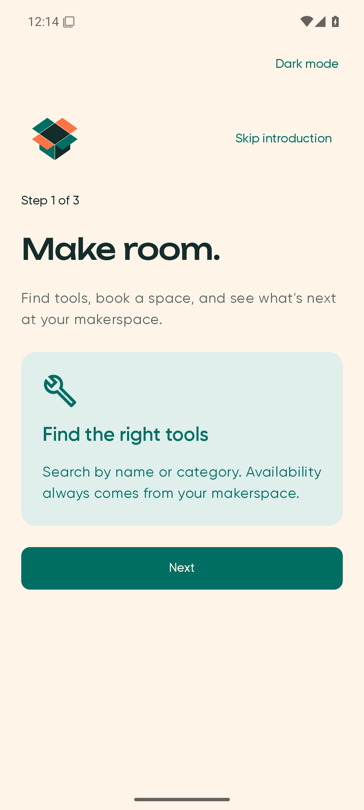
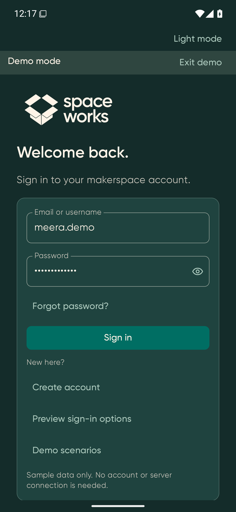
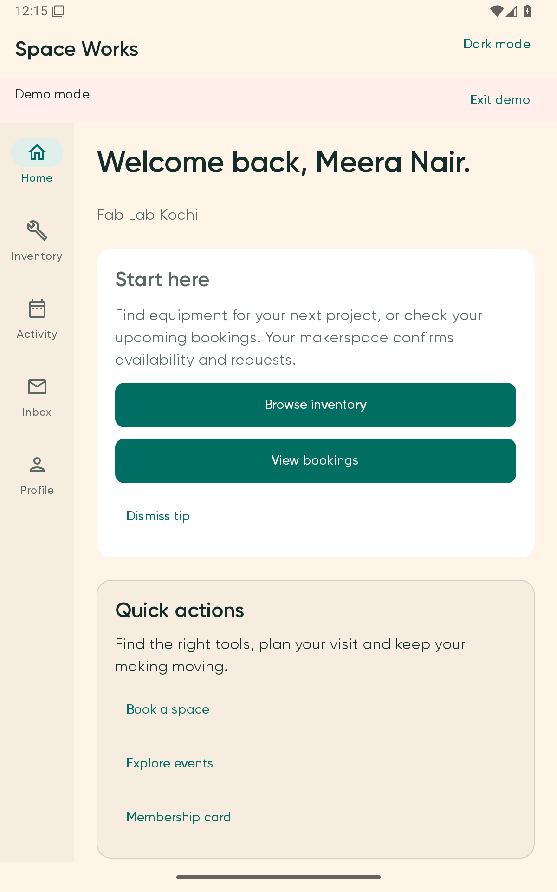
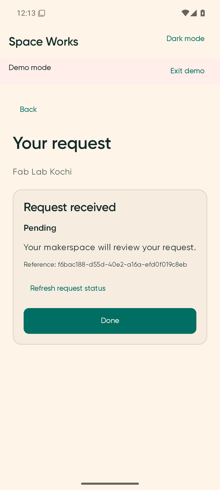
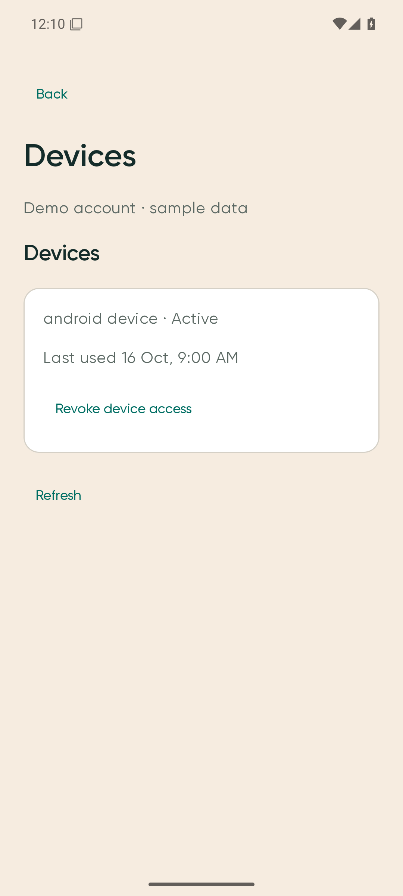
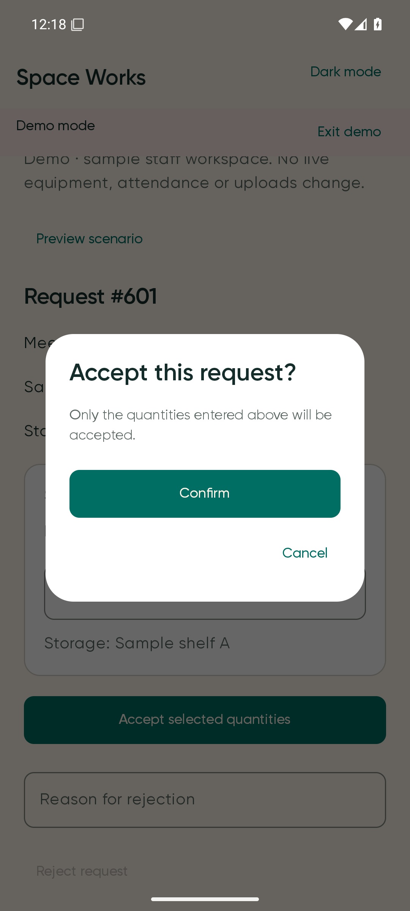

<p align="center">
  <br>
  <picture>
    <source media="(prefers-color-scheme: dark)" srcset="docs/images/brand/space-works-dark.png">
    
  </picture>
  <br><br>
</p>

# Space Works for Android

Find tools. Book a space. Keep your making moving.

A native **Kotlin + Jetpack Compose** app for makerspace members and staff, with Material 3 controls, adaptive phone/tablet navigation, supplied Gilroy typography, light/dark themes and accessible text scaling. Runs on **Android 8+ (API 26)** and targets **API 36**.

Also available as a native [iOS app](https://github.com/SpaceWorks-HQ/SpaceWorks-iOS).

The backend will be supplied later. Debug includes an explicitly labelled, isolated demo; live provider, payment, push and store acceptance remain separate deployment gates.

## Screenshots

Original full-OS emulator captures from tested app commit [`11cc205`](https://github.com/SpaceWorks-HQ/SpaceWorks-Android/commit/11cc205c39294baeb3116038a5eb525519813eab). The gallery includes labelled Debug sample flows. Open any image for its full size; [capture provenance](docs/images/PROVENANCE.json) records the source, artifact and original-byte hashes.

| Introduction | Sign in · dark | Tablet Home |
| --- | --- | --- |
| [](docs/images/screenshots/introduction.png) | [](docs/images/screenshots/sign-in-dark.png) | [](docs/images/screenshots/tablet-home.png) |
| Request receipt | Account devices | Staff confirmation |
| [](docs/images/screenshots/request-receipt.png) | [](docs/images/screenshots/account-devices.png) | [](docs/images/screenshots/staff-confirmation.png) |

## What’s inside

- Inventory search, equipment requests, bookings, events, membership cards and inbox updates.
- Account/profile settings, security and device sessions, membership actions and export journeys.
- Authorized staff issue, return and check-in flows with explicit review and evidence steps.
- Replayable introduction, scoped Home tips and **Profile → App guide**.
- Native document previews, notification routing, system-aware motion and owned haptic feedback.

Production uses the generated [OpenAPI client](api/README.md). Features without the required native contract or deployment configuration remain honestly unavailable; demo success never establishes a live session, charge or deletion. See [backend dependencies](https://github.com/SpaceWorks-HQ/SpaceWorks-Android/issues/3) and the [release handoff](docs/RELEASE-READINESS.md).

## Build and run

Install **Java 21**, **Python 3**, Android Studio and **Android SDK 36**. Clone with submodules and configure `ANDROID_HOME` or an untracked `local.properties`:

```sh
git clone --recurse-submodules https://github.com/SpaceWorks-HQ/SpaceWorks-Android.git
cd SpaceWorks-Android
git switch dev
git submodule update --init --recursive
./gradlew lint test assembleDebug assembleRelease bundleRelease
```

Use `gradlew.bat` on Windows. Open the repository in Android Studio and run `app`; choose **Explore demo** in Debug to try the member and staff flows without a backend. Release omits demo entry points and implementations. Debug APKs are installable for development; CI Release outputs are unsigned and Play distribution requires owner signing/provisioning.

For instrumented journeys, start an emulator/device and run `./gradlew connectedDebugAndroidTest`. Gradle generates branding, motion, copy and API sources from the repository inputs; generated output stays outside Git.

## Verified app baseline

Evidence below is bound to app commit **`11cc205`**, separately from any later README-only commit.

| Gate | Accepted result |
| --- | --- |
| [Canonical dev CI](https://github.com/SpaceWorks-HQ/SpaceWorks-Android/actions/runs/39081399951) | Build, lint, Debug/Release validation and default device jobs passed |
| [Full device matrix](https://github.com/SpaceWorks-HQ/SpaceWorks-Android/actions/runs/39081400622) | 59 UI tests × 10 profiles = **590**, zero failures or skips |
| Unit tests | **538 Debug + 506 Release**, zero failures or skips |
| Native/UI proof | Supplied font resolution, haptic dispatch/settings, measured profiles, real keyboard insets and configuration-backed 3.2× PDF dialog layout |
| Packaging and review | 16 KB APK/ELF alignment checks; **210 original full-OS screenshots** manually reviewed |

The matrix covers compact through large phones, 600/800/840/1024dp tablets and tablet landscape, across light/dark and large text. Emulators do not establish tactile quality, live provider/backend operation or the separate physical 16 KB runtime-device gate.

## Configuration and documentation

Set deployment branding and an optional locked HTTPS origin in [`branding/brand.json`](branding/brand.json). Keep provider keys, signing files and credentials untracked. The supplied logo masters and font provenance are retained; use the [white-label guide](docs/WHITE-LABEL.md) for supported replacements.

[User guide](docs/USER-GUIDE.md) · [Release readiness](docs/RELEASE-READINESS.md) · [Store listing](docs/STORE-LISTING.md) · [Local API evidence](docs/LOCAL-DOCKER-VALIDATION.md) · [Changelog](docs/CHANGELOG.md) · [PRD](docs/PRD.md)

[Contributing](CONTRIBUTING.md) · [Security policy](SECURITY.md) · [Dependency provenance](docs/DEPENDENCIES.md)

Ongoing work stays on `dev`, with tested phase commits pushed there. The owner authorized the existing [PR #4](https://github.com/SpaceWorks-HQ/SpaceWorks-Android/pull/4) for delivery to `main`: merge only its reviewed head after exact-source CI and visual gates pass. Preserve `dev` and phase commits; do not create other pull requests or feature branches. Keep the PRD, API contract and pinned Design inputs unchanged.
